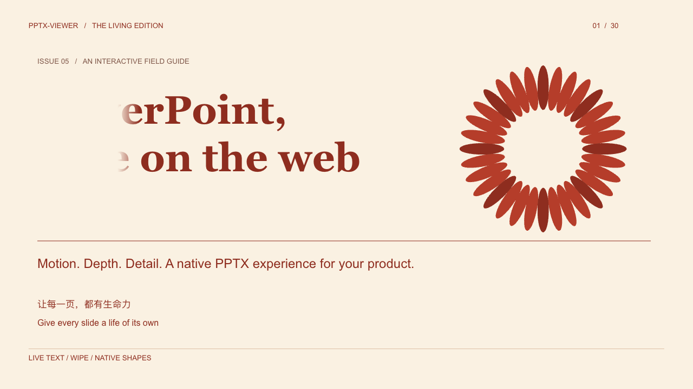
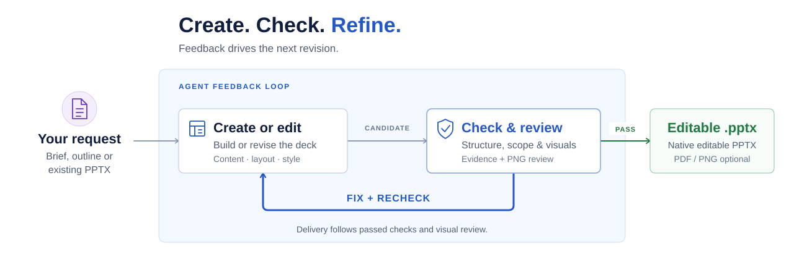

# pptx-nova

English | [简体中文](README.zh-CN.md)

`pptx-nova` is an agent skill for creating, editing, refurbishing, translating, and checking
PowerPoint presentations. It is designed to deliver real, editable `.pptx`
files, not slide screenshots pasted into a deck.

Use it when you want an AI agent to turn a brief, outline, Markdown/text
document, pasted table, CSV/JSON data, reference deck, or existing presentation
into an editable PowerPoint file. The primary target is PowerPoint; Keynote and
other compatible office suites can usually open the result, subject to their
PPTX compatibility.

## See the results

[](https://structurify.io/en/showcases/copper-motion/)

A 20-second recording of native PPTX playback in the browser. Click the preview for the full interactive showcase.

Explore presentations created with `pptx-nova` directly in your browser:

- [Quiet Canvas](https://structurify.io/en/showcases/quiet-canvas/) · [PPTX source](showcases/D1-Quiet-Canvas.pptx)
- [Electric Stage](https://structurify.io/en/showcases/electric-stage/) · [PPTX source](showcases/D2-Electric-Stage.pptx)
- [Copper Motion](https://structurify.io/en/showcases/copper-motion/) · [PPTX source](showcases/D5-Copper-Motion.pptx)
- [Signal Depth](https://structurify.io/en/showcases/signal-depth/) · [PPTX source](showcases/D6-Signal-Depth.pptx)

Tip: Click the triangular play button in the bottom-right corner of a showcase to see it in action.
**These are real, native, editable PPTX files!**

## Install the skill

Install only the user-facing `pptx-nova` skill from this repository:

```bash
npx skills add hustcer/pptx-nova --skill pptx-nova
```

The default scope is the current project. For a global installation to a specific Agent:

```bash
# Claude Code
npx skills add hustcer/pptx-nova --skill pptx-nova -g -a claude-code -y

# Codex
npx skills add hustcer/pptx-nova --skill pptx-nova -g -a codex -y
```

`-g` installs at user scope, `-a` selects the Agent, and `-y` skips confirmation prompts.
To list the repository's skills without installing them, run
`npx skills add hustcer/pptx-nova --list`. The `deckkit-maker` skill is for DeckKit
development and is not required to use `pptx-nova`.

The skill installer does not install the `xdoc` runtime. Real PPTX creation, editing,
conversion, and preview workflows also require `xdoc` on the Agent's `PATH`.
Install the documented release separately with Node.js 22+:

```bash
npm i -g @s8fy/xdoc@0.19.0
xdoc --version
```

See the [xdoc installation guide](docs/xdoc-installation.md) for native archives,
platform requirements, and runtime verification. After setup, describe the presentation
task to your Agent in plain language. For license installation, renewal, or
authorization problems, ask the Agent to use pptx-nova's
[licensing workflow](pptx-nova/references/runtime/licensing.md).

### xdoc Runtime plans

|                                 | Free                               | Personal (licensed plan)                                                                   |
| ------------------------------- | ---------------------------------- | ------------------------------------------------------------------------------------------ |
| Current price                   | Free                               | Free — [apply for a license](https://structurify.io/en/commerce/?product=runtime-personal) |
| License                         | No account or license required     | Offline individual license, valid for 30 days                                              |
| Slides per task                 | Up to 10                           | No plan-level limit                                                                        |
| Compressed PPTX inputs per task | Up to 5 MiB combined               | No plan-level limit                                                                        |
| PPTX, PDF, and PNG outputs      | Carry a `structurify.io` watermark | No new plan watermark when the task is authorized                                          |

Both plans support single-user local use, local scripts, and a per-user daemon.
Format and resource limits and existing signed watermark rules still apply.
Personal is currently free for personal local noncommercial use, with no plans
to charge for this use in the near term. See the linked application page for
license terms.

## Powered by [`xdoc`](docs/xdoc-introducution.md)

xdoc is an agent-native document execution runtime for native, editable PPTX work.

> **xdoc is a high-performance, agent-first, headless PPTX runtime built for high-fidelity creation and editing.**

The verified release is `0.19.0 (93aafd96)`. It exposes runtime discovery,
native editable creation and modification, dry-runs, preservation diagnostics,
rendering, validation, and auditable evidence. Support is specific to each
object and operation; it does not imply complete PowerPoint feature parity.

pptx-nova is built on `xdoc`, an in-house PPTX engine for AI agents. It can inspect
the real PowerPoint file structure, validate declarative JSON patches with
dry-runs, apply native editable changes, render previews, compare source and
candidate decks, export existing or generated presentations to high-fidelity
PDF, and leave replayable sidecar evidence.

All of this runs through a single lightweight native CLI with integrated
rendering backends: previews, PDF export, and visual checks require no
PowerPoint, office suite, or headless browser. The current `v0.19.0` native
archives download as approximately 8.4–10.3 MB (decimal), depending on the target, and need no
separate server or always-on background service. Native builds are available
for Linux x64/ARM64, macOS 13+ ARM64, and Windows x64. Rendering still depends
on the available fonts and the support status of the requested feature.

Install the published CLI with `npm i -g @s8fy/xdoc@0.19.0` (Node.js 22+), or
use a [native release archive](docs/xdoc-installation.md). Free mode supports
single-user local tasks up to 10 slides and 5 MiB of compressed PPTX inputs
combined; editable PPTX, PDF, and PNG outputs carry a `structurify.io` watermark.
Local scripts and a per-user daemon are supported. The launch Free, Personal,
and Enterprise plans do not include CI, shared servers, or Service/API use;
deployment in those environments requires separately applicable authorization.
Public downloads use non-commercial terms unless separately licensed.
The canonical automated visual audit requires unwatermarked conversion
authorization; Free mode can still produce watermarked previews for review.

That changes the workflow: pptx-nova can plan a deck with DeckKits, edit real
PPTX objects instead of screenshots, check selectors before writing, preserve
the original deck by default, and produce review artifacts that make the result
auditable. It is closer to a structured PPTX build/edit pipeline than a
one-shot slide generator.

New-deck creation and existing-deck editing use different models. New decks are
generated from structured content, while existing decks are edited through
source-preserving patches to their native PPTX objects rather than being
reconstructed slide by slide. The source remains read-only by default, and the
result is published as a separately validated candidate.

## What pptx-nova can do

- Create a new presentation from a short brief, structured outline,
  Markdown/text document, PDF, web page, pasted table, or CSV/JSON data.
- Rebuild editable PPTX files from structured JSON deck sources, making decks
  easier to version, review, replay, and regenerate with visual checks.
- Refurbish an existing deck with the goal of preserving the original content
  while making the visual system cleaner and more consistent, and deliver
  source-vs-final comparison images covering every slide for review.
- Translate an existing `.pptx` into another language while aiming to preserve
  original deck structure, layout, styles, objects, notes, animations, and
  visual hierarchy, and deliver source-vs-translation comparison images
  covering every slide for review.
- Edit existing decks, including titles, copy, slide order, visuals, colors,
  charts, tables, and selected page elements.
- Preserve explicit current-deck follow-up rules, such as applying the same
  title color to slides added later, and verify supported rules in the final PPTX.
- Inspect real PPTX structure, select exact target objects, dry-run edits, and
  apply changes to validated candidates before publishing a final file.
- Use a company template or reference deck as a guide while avoiding
  unapproved reuse of private or non-redistributable assets.
- Fill supported content into an existing PPTX template or copy selected slides
  between decks, subject to template, slide-size, and resource checks.
- Apply or check brand, theme, and visual-system changes through DeckKit and
  `xdoc` workflows where supported.
- Generate data-driven slides from CSV/JSON data, using editable tables,
  charts, diagrams, and shapes where supported.
- Create or safely edit supported PPTX animations and transitions.
- Convert existing or generated PPTX decks to high-fidelity PDF, and render PNG
  previews for visual review.
- Extract supported deck content and metadata as Markdown, text, or JSON,
  including notes, links, fonts, and resources; run preflight checks for fonts,
  links, compatibility, or accessibility.
- Run quality checks that look for overlap, clipped text, layout drift,
  template violations, content-preservation issues, visual defects, and
  before/after drift.

## Our other products

- **[xdoc Runtime](https://structurify.io/en/products/pptx-runtime/)** — An Agent-ready native
  CLI to inspect, create, edit, render, and verify PowerPoint files.
- **[PPTX Viewer](https://structurify.io/en/products/pptx-viewer/)** — A browser SDK for
  PowerPoint preview and supported animation playback, with Web Component and framework integrations.
- **[PPTX Converter](https://structurify.io/en/products/pptx-converter/)** — An SDK for local
  PPTX-to-PDF and Markdown conversion in browsers, Node.js, Bun, and Deno.
- **[PPTX API Service](https://structurify.io/en/products/pptx-api/)** — An HTTP service designed
  for **private deployment via Docker images**, with PPTX conversion, extraction, and checks.
  Currently a loopback-only development preview; production deployment is not yet available.

## Typical requests

You can start with a plain-language instruction:

```text
Use pptx-nova to create an 8-slide English product strategy deck for a SaaS
leadership team. Use a clean consulting style and save it as strategy-review.pptx.
```

Or ask it to refurbish an existing deck:

```text
Refurbish qbr.pptx. Keep the content and slide count, make the visual design more
consistent and executive-ready, and export qbr-refined.pptx plus PNG previews.
```

Or make a precise edit:

```text
Update sales-review.pptx: change the title on slide 2, replace the KPI table on
slide 5 with data from metrics.csv, and write the result to sales-review-v2.pptx.
```

Or translate a presentation while retaining the source:

```text
Translate product-launch.pptx from Chinese to English. Preserve the original
layout, formatting, charts, speaker notes, animations, and slide count. Use
concise US English terminology and write product-launch-en.pptx.
```

Or export an existing presentation:

```text
Convert proposal.pptx to a high-fidelity PDF and save it as proposal.pdf.
```

Or reuse an existing template:

```text
Fill company-template.pptx with the quarterly results in metrics.csv. Keep the
company's visual style and save the new presentation as quarterly-results.pptx.
```

## What to provide

You can give a single sentence, but results are usually better when you include:

- Purpose: pitch, board update, QBR, sales deck, training, proposal, lecture, or
  workshop.
- Audience: executives, customers, investors, sales teams, students, internal
  teams, or public conference attendees.
- Length: exact slide count or an approximate range.
- Language: English, Chinese, bilingual, or another target language.
- Source material: outline, notes, Markdown/text content, existing PPTX, PDF,
  CSV/JSON, screenshots, links, product copy, brand assets, or a template deck.
- Translation target, when translating: source language if mixed or ambiguous,
  target language and locale, terminology preferences, tone, and whether chart
  labels, alt text, link text/tooltips, or speaker notes should be localized.
- Style direction: formal, minimal, consulting, technical, editorial, product
  marketing, training-oriented, or strict brand template.
- Constraints: content that must not change, slides that must be preserved,
  whether restructuring is allowed, and the required output path.

By default, pptx-nova should not overwrite your original deck. Ask for a new
output filename unless you intentionally want to replace a file.

HTML, web pages, and PDFs are treated as source material. They are first
normalized into text or Markdown and then routed through the deck workflow;
pptx-nova does not promise to copy their original page layout, imagery, or
styles into PowerPoint one-to-one. PDF extraction quality depends on the source;
scans or embedded fonts can result in missing characters or incorrect reading
order, so check the extracted content. CSV and JSON can provide tabular data;
arbitrary JSON, Excel workbooks, and Word documents are not direct deck inputs.

## Outputs

A normal run can produce:

- A final editable `.pptx` file.
- A high-fidelity PDF export and optional per-slide PNG previews.
- Optional validation reports for visual checks, template checks, and
  content-preservation checks.
- For translation or refurbishment runs, side-by-side comparison images that
  cover each source slide and its delivered result. Decks up to 20 slides use
  one image; larger decks use numbered images and a coverage manifest.
- For translation runs, optional source-language/target-language review notes
  that show what was translated, what was intentionally shortened, and any
  layout risks that still deserve human review.
- A short summary of what changed and any remaining review risks.

Run evidence is normally retained under `.pptx-nova/<run>/`, including the
capability snapshot, relevant plans or patches, validation reports, and visual
review artifacts. Successful runs may be slimmed while retaining their essential
evidence; failed or interrupted runs are kept for inspection or resumption.

For high-stakes decks, treat the generated file as a strong draft and still do a
human review of facts, claims, numbers, brand compliance, and legal language.

## How it works

Describe the result you need. pptx-nova creates or edits the deck, checks it,
and uses machine findings and visual review to guide the next revision.
Fixes return to validation; delivery follows the required checks and review.

<p align="center">
  
</p>

New decks use DeckKits: reusable visual systems with page types, typography,
layout rules, and quality checks. Existing decks are edited through scoped
changes to their native objects, with the original file kept read-only by
default.

See the [full creation and editing workflows](docs/workflows.md) for the
detailed steps, validation gates, and retry paths.

### Capability and playback boundaries

pptx-nova discovers capabilities from the installed `xdoc` runtime for each
run. Creating, editing, preserving, rendering, and verifying an object are
separate capabilities: a feature that can be preserved or rendered is not
necessarily editable. Complex animations and other unsupported regions may
need to remain untouched or require a different workflow. See the
[compatibility reference](docs/xdoc-compatibility.md) for current boundaries.

PNG and PDF previews show static slides; they do not prove that animations or
transitions play correctly in PowerPoint. When playback matters, review it in
the intended presentation environment and treat unavailable playback evidence
as a remaining review risk.

### Scoped edit safety

For localized edits, pptx-nova records the intended scope before writing and
publishes the candidate only after a deterministic gate confirms that:

- requested targets were covered without reliable out-of-scope changes;
- source, candidate, and validation evidence still belong together; and
- relevant formatting and visual-regression checks passed.

Failures are blocked with a specific next action instead of being silently
delivered. Complex or uncertain PPTX regions can still require specialized
checks or human review.

### Reliable follow-up rules

For multi-turn work on the same deck, pptx-nova can preserve explicit
future/carryover instructions instead of relying on temporary chat memory. It
records the rule against the current deck revision, resolves conflicts and
one-time overrides, and verifies supported style rules in the final PPTX before
delivery.

The current scope is deliberately narrow and deterministic. It does not infer
long-term preferences from vague feedback, create a cross-project user profile,
or allow a session rule to bypass template and quality checks. Rules that do not
apply to the current edit add no extra edit target or delivery evidence.

This is the part that makes pptx-nova different from many generic slide
generators, screenshot pipelines, or small PowerPoint scripting snippets:

- It aims to produce native editable PPTX objects, not a deck made of flattened
  slide images.
- It keeps a durable plan (`outline.json`, `deck_lock.json`, `content.json`, or
  `patch.json`) so the work can be reviewed, replayed, and continued.
- It uses `xdoc`'s `inspect`, `select`, `dry-run`, `apply`, `preview`,
  `vision-check`, `diff`, and sidecar/replay capabilities as guardrails around
  the actual file write.
- It treats the original deck as read-only by default and writes validated
  candidates before publishing a final file.
- It leaves a small audit trail of reports and previews so users can see what
  changed, what was checked, and what still deserves human review.

The result is still a document that should be reviewed like any business
presentation, especially for facts, numbers, legal wording, and brand approval.
The workflow is designed to make that review easier: the deck stays editable,
the changes are traceable, and visual defects are looked for before delivery.

## Translating presentations

Translation is handled as a style-preserving edit, not as deck recreation. The
source deck stays read-only, and the translated file is written to a separate
output path.

For translation requests, provide at least:

- Source `.pptx` path.
- Target language, and source language when the deck is mixed-language or
  ambiguous.
- Output `.pptx` path.
- Terminology, locale, tone, or brand wording requirements.

Translation aims to preserve bold, italic, underline, strikethrough, colors,
fonts, alignment, bullets, indentation, text box geometry, table and chart
styling, hyperlinks, notes, animations, and transitions unless you explicitly
ask for a broader redesign.

Because translated text often expands or wraps differently, fitting fixes should
be conservative: first use shorter wording without changing the meaning, then
make small font-size adjustments if needed, and only change text box geometry
when the slide clearly has room.

Translation checks should cover more than ordinary slide text. Chart titles,
series names, category labels, data labels, table cells, alt text, hyperlink
tooltips, and speaker notes can also contain user-visible text and may need
translation.

Do not treat a translated deck as complete just because text replacement
succeeded. The final review must confirm that the target-language deck still
looks like the source deck, has no remaining source-language visible text that
should have been translated, and has no new clipping, overlap, broken chart
labels, lost formatting, or PowerPoint repair issues.

## Repository layout

```text
.
+-- pptx-nova/                 # The main publishable pptx-nova skill
|   +-- README.md              # English user guide
|   +-- README.zh-CN.md         # Chinese user guide
|   +-- SKILL.md               # Agent instructions and task routing
|   +-- assets/                # DeckKits, examples, themes, icons, schemas
|   +-- benchmarks/visual/     # Visual benchmark cases and baselines
|   +-- references/            # Workflow references for agents and maintainers
|   +-- scripts/               # Skill runtime scripts and helper gates
|   `-- evals/                 # Skill evaluation metadata
+-- deckkit-maker/             # Developer-side helper skill for DeckKit creation
`-- tools/                     # Repository-level smoke and public-release checks
```

## DeckKit examples

Committed showcase assets live under `pptx-nova/assets/examples/deckkits/`. They are
synthetic, redistributable examples, not customer materials. Each example
usually includes the generated editable `deck.pptx`, a compact contact sheet,
the source `content.json`, a brief, and summary metadata.

DeckKit runtime code lives under `pptx-nova/assets/deckkits/`. Use the bundled
catalog and validation scripts instead of ad hoc one-off slide generators for
ordinary deck delivery.

## Maintainer checks

Run the full repository test suite with `node tools/run-tests.mjs`.

Run the repository-level smoke test before publishing or packaging the skill:

```bash
node tools/pptx-nova-smoke-test.mjs
```

Run the public-audit gate when preparing a public release:

```bash
node tools/pptx-nova-audit-public.mjs --strict
```

The smoke test validates bundled DeckKit content, builds a patch, queries the
bundled icon pack, checks DeckKit selection, exercises session-rules
normalization/resolution, and verifies Edit Contract source and evidence
bindings. The public audit scans for machine-local paths, private repository
context, unexpected binaries, missing license requirements, and other release
blockers.

To check an installed xdoc's native edit, autofit, translation, sidecar-publication and asset-boundary
contracts, including the published Edit Contract gate with real semantic/style/visual
reports, run the opt-in executable suite:

```bash
XDOC_TEST_BIN=/absolute/path/to/xdoc node --test tools/tests/contracts/native-contracts.test.mjs
```

The default test suite skips these cases when `XDOC_TEST_BIN` is absent. Set
`XDOC_TEST_EVIDENCE_DIR` to retain the independently allocated scenario outputs;
these maintainer tests are not dependencies of the published skill.

Add `XDOC_TEST_VISUAL=1` to also check every Cartesian stock page through
canonical PDF/PNG Create gates. This additional case uses the installed
authorization and requires an unwatermarked CLI License; the ordinary native
cases keep isolated configuration. Evidence directories may be relative or absolute.

`xdoc` is the in-house, agent-oriented PPTX engine behind pptx-nova, exposed to
the skill through its primary CLI. pptx-nova uses it for PowerPoint inspection,
declarative patch dry-runs and application, conversion, preview rendering,
semantic diff, and visual checks. Some metadata validation and DeckKit selection
scripts can run without `xdoc`, but real PPTX apply, conversion, preview, diff,
and vision-check workflows require it.

## About deckkit-maker

`deckkit-maker` is included as a companion developer skill. It exists to create,
repair, and benchmark new DeckKits for pptx-nova from a reference `.pptx` file
or an HTML slide template.

It is not the main user-facing deck generation path. For normal presentation
creation, editing, refurbishment, and QA, use `pptx-nova`. Use `deckkit-maker`
only when the existing DeckKits are not enough and the reusable visual system
itself needs to be built or extended.

## Acknowledgments

- [Tabler Icons](https://github.com/tabler/tabler-icons)
- [PPT Master](https://github.com/hugohe3/ppt-master)
- [Beautiful HTML Templates](https://github.com/zarazhangrui/beautiful-html-templates)
- [PPTAgent: Generating and Evaluating Presentations Beyond Text-to-Slides](https://arxiv.org/abs/2501.03936)

## More documentation

- [pptx-nova user guide](pptx-nova/README.md)
- [pptx-nova 中文使用指南](pptx-nova/README.zh-CN.md)
- [xdoc introduction and architecture](docs/xdoc-introducution.md)
- [Install the xdoc CLI](docs/xdoc-installation.md)
- [xdoc compatibility reference](docs/xdoc-compatibility.md)
- [DeckKit examples](pptx-nova/assets/examples/deckkits/README.md)
