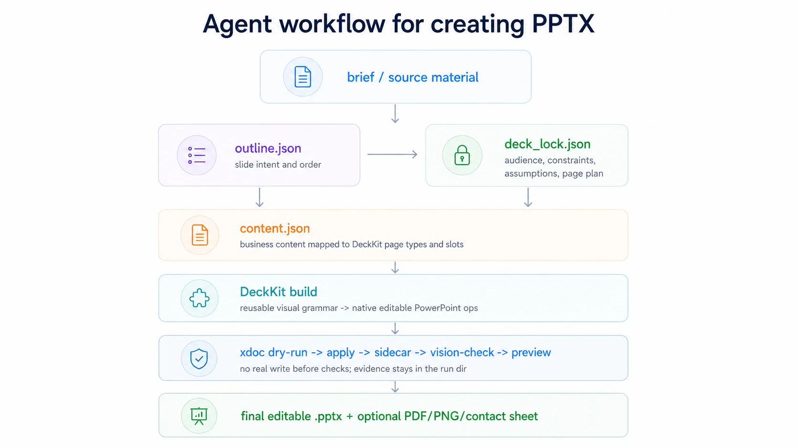
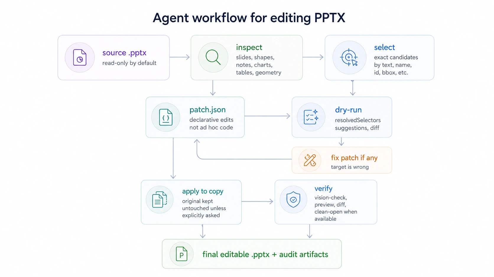

# pptx-nova

`pptx-nova` is an agent skill for creating, editing, refurbishing, translating, and checking
PowerPoint presentations. It is designed to deliver real, editable `.pptx`
files, not slide screenshots pasted into a deck.

Use it when you want an AI agent to turn a brief, outline, Markdown/text
document, pasted table, CSV/JSON data, reference deck, or existing presentation
into an editable PowerPoint file. The primary target is PowerPoint; Keynote and
other compatible office suites can usually open the result, subject to their
PPTX compatibility.

## Powered by [`xdoc`](docs/xdoc-introducution.md)

xdoc is an agent-native document execution runtime for native, editable PPTX work.

> **xdoc is the best agent-first, headless PPTX runtime for high-fidelity creation and editing.**

That is a deliberately bold positioning statement, backed by a July 2026
Agent-oriented comparison of current PPTX creation and editing tools. Within
the evaluated set, xdoc ranked highest overall for the combined workflow of
runtime discoverability, native editable creation and modification, dry-run
safety, preservation, rendering, validation, and auditable evidence, while the
current `v0.3.5` native packages remain roughly 20MB each. The claim is scoped
to that evaluated set and workflow; it is not a claim of complete PowerPoint
feature parity or superiority over every tool that may exist.

Most slide-generation tools either create flattened slide images or rely on
small, brittle PowerPoint scripting snippets. pptx-nova is built on `xdoc`, an
in-house PPTX engine designed from the ground up for AI agents. It can inspect
the real PowerPoint file structure, validate declarative JSON patches with
dry-runs, apply native editable changes, render previews, compare source and
candidate decks, export existing or generated presentations to high-fidelity
PDF, and leave replayable sidecar evidence.

All of this runs through a single lightweight native CLI with integrated
rendering backends: previews, PDF export, and visual checks require no
PowerPoint, office suite, or headless browser. The current `v0.3.5` native
packages unpack to roughly 20MB each, depending on the target, and need no
separate server or always-on background service. Native builds are available
for supported Linux, macOS, and Windows targets, keeping the whole pipeline
practical in CI, containers, and unattended agent environments.

That changes the workflow: pptx-nova can plan a deck with DeckKits, edit real
PPTX objects instead of screenshots, check selectors before writing, preserve
the original deck by default, and produce review artifacts that make the result
auditable. It is closer to a structured PPTX build/edit pipeline than a
one-shot slide generator.

New-deck creation and existing-deck editing use different models. New decks are
generated from structured content, while existing decks are edited through
source-preserving patches to their native PPTX objects rather than being
reconstructed slide by slide. The source remains read-only by default, and the
result is published as a separately validated candidate.

## What pptx-nova can do

- Create a new presentation from a short brief, structured outline,
  Markdown/text document, PDF, web page, pasted table, or CSV/JSON data.
- Rebuild editable PPTX files from structured JSON deck sources, making decks
  easier to version, review, replay, and regenerate with visual checks.
- Refurbish an existing deck with the goal of preserving the original content
  while making the visual system cleaner and more consistent, and deliver a
  single all-slides source-vs-final comparison image for review.
- Translate an existing `.pptx` into another language while aiming to preserve
  original deck structure, layout, styles, objects, notes, animations, and
  visual hierarchy, and deliver a single all-slides source-vs-translation
  comparison image for review.
- Edit existing decks, including titles, copy, slide order, visuals, colors,
  charts, tables, and selected page elements.
- Preserve explicit current-deck follow-up rules, such as applying the same
  title color to slides added later, and verify supported rules in the final PPTX.
- Inspect real PPTX structure, select exact target objects, dry-run edits, and
  apply changes to validated candidates before publishing a final file.
- Use a company template or reference deck as a guide while avoiding
  unapproved reuse of private or non-redistributable assets.
- Apply or check brand, theme, and visual-system changes through DeckKit and
  `xdoc` workflows where supported.
- Generate data-driven slides from CSV/JSON data, using editable tables,
  charts, diagrams, and shapes where supported.
- Create or safely edit supported PPTX animations and transitions.
- Convert existing or generated PPTX decks to high-fidelity PDF, and render PNG
  previews for visual review.
- Run quality checks that look for overlap, clipped text, layout drift,
  template violations, content-preservation issues, visual defects, and
  before/after drift.

## Typical requests

You can start with a plain-language instruction:

```text
Use pptx-nova to create an 8-slide English product strategy deck for a SaaS
leadership team. Use a clean consulting style and save it as strategy-review.pptx.
```

Or ask it to refurbish an existing deck:

```text
Refurbish qbr.pptx. Keep the content and slide count, make the visual design more
consistent and executive-ready, and export qbr-refined.pptx plus PNG previews.
```

Or make a precise edit:

```text
Update sales-review.pptx: change the title on slide 2, replace the KPI table on
slide 5 with data from metrics.csv, and write the result to sales-review-v2.pptx.
```

Or translate a presentation in place:

```text
Translate product-launch.pptx from Chinese to English. Preserve the original
layout, formatting, charts, speaker notes, animations, and slide count. Use
concise US English terminology and write product-launch-en.pptx.
```

Or export an existing presentation:

```text
Convert proposal.pptx to a high-fidelity PDF and save it as proposal.pdf.
```

## What to provide

You can give a single sentence, but results are usually better when you include:

- Purpose: pitch, board update, QBR, sales deck, training, proposal, lecture, or
  workshop.
- Audience: executives, customers, investors, sales teams, students, internal
  teams, or public conference attendees.
- Length: exact slide count or an approximate range.
- Language: English, Chinese, bilingual, or another target language.
- Source material: outline, notes, Markdown/text content, existing PPTX, PDF,
  CSV/JSON, screenshots, links, product copy, brand assets, or a template deck.
- Translation target, when translating: source language if mixed or ambiguous,
  target language and locale, terminology preferences, tone, and whether chart
  labels, alt text, link text/tooltips, or speaker notes should be localized.
- Style direction: formal, minimal, consulting, technical, editorial, product
  marketing, training-oriented, or strict brand template.
- Constraints: content that must not change, slides that must be preserved,
  whether restructuring is allowed, and the required output path.

By default, pptx-nova should not overwrite your original deck. Ask for a new
output filename unless you intentionally want to replace a file.

HTML, web pages, and PDFs are treated as source material. They are first
normalized into text or Markdown and then routed through the deck workflow;
pptx-nova does not promise to copy their original page layout, imagery, or
styles into PowerPoint one-to-one.

## Outputs

A normal run can produce:

- A final editable `.pptx` file.
- A high-fidelity PDF export and optional per-slide PNG previews.
- Optional validation reports for visual checks, template checks, and
  content-preservation checks.
- For translation or refurbishment runs, a single all-slides side-by-side
  comparison image that helps review each source slide against the delivered
  result.
- For translation runs, optional source-language/target-language review notes
  that show what was translated, what was intentionally shortened, and any
  layout risks that still deserve human review.
- A short summary of what changed and any remaining review risks.

For high-stakes decks, treat the generated file as a strong draft and still do a
human review of facts, claims, numbers, brand compliance, and legal language.

## How it works

pptx-nova uses a DeckKit-first workflow. A DeckKit is a reusable visual system
with page types, layout rules, typography, color rules, and quality checks. The
normal new-deck path is:

<p align="center">
  
</p>

The typical existing-deck edit path is intentionally different from a one-shot
"rewrite the file" flow. pptx-nova asks `xdoc` to inspect the real PPTX structure
first, selects the exact target objects, and checks the patch before writing:

<p align="center">
  
</p>

### Scoped edit safety

For localized edits, pptx-nova records the intended scope before writing and
publishes the candidate only after a deterministic gate confirms that:

- requested targets were covered without reliable out-of-scope changes;
- source, candidate, and validation evidence still belong together; and
- relevant formatting and visual-regression checks passed.

Failures are blocked with a specific next action instead of being silently
delivered. Complex or uncertain PPTX regions can still require specialized
checks or human review.

### Reliable follow-up rules

For multi-turn work on the same deck, pptx-nova can preserve explicit
future/carryover instructions instead of relying on temporary chat memory. It
records the rule against the current deck revision, resolves conflicts and
one-time overrides, and verifies supported style rules in the final PPTX before
delivery.

The current scope is deliberately narrow and deterministic. It does not infer
long-term preferences from vague feedback, create a cross-project user profile,
or allow a session rule to bypass template and quality checks. Rules that do not
apply to the current edit add no extra edit target or delivery evidence.

This is the part that makes pptx-nova different from many generic slide
generators, screenshot pipelines, or small PowerPoint scripting snippets:

- It aims to produce native editable PPTX objects, not a deck made of flattened
  slide images.
- It keeps a durable plan (`outline.json`, `deck_lock.json`, `content.json`, or
  `patch.json`) so the work can be reviewed, replayed, and continued.
- It uses `xdoc`'s `inspect`, `select`, `dry-run`, `apply`, `preview`,
  `vision-check`, `diff`, and sidecar/replay capabilities as guardrails around
  the actual file write.
- It treats the original deck as read-only by default and writes validated
  candidates before publishing a final file.
- It leaves a small audit trail of reports and previews so users can see what
  changed, what was checked, and what still deserves human review.

The result is still a document that should be reviewed like any business
presentation, especially for facts, numbers, legal wording, and brand approval.
The workflow is designed to make that review easier: the deck stays editable,
the changes are traceable, and visual defects are looked for before delivery.

## Translating presentations

Translation is handled as a style-preserving edit, not as deck recreation. The
source deck stays read-only, and the translated file is written to a separate
output path.

For translation requests, provide at least:

- Source `.pptx` path.
- Target language, and source language when the deck is mixed-language or
  ambiguous.
- Output `.pptx` path.
- Terminology, locale, tone, or brand wording requirements.

Translation aims to preserve bold, italic, underline, strikethrough, colors,
fonts, alignment, bullets, indentation, text box geometry, table and chart
styling, hyperlinks, notes, animations, and transitions unless you explicitly
ask for a broader redesign.

Because translated text often expands or wraps differently, fitting fixes should
be conservative: first use shorter wording without changing the meaning, then
make small font-size adjustments if needed, and only change text box geometry
when the slide clearly has room.

Translation checks should cover more than ordinary slide text. Chart titles,
series names, category labels, data labels, table cells, alt text, hyperlink
tooltips, and speaker notes can also contain user-visible text and may need
translation.

Do not treat a translated deck as complete just because text replacement
succeeded. The final review must confirm that the target-language deck still
looks like the source deck, has no remaining source-language visible text that
should have been translated, and has no new clipping, overlap, broken chart
labels, lost formatting, or PowerPoint repair issues.

## Repository layout

```text
.
+-- pptx-nova/                 # The main publishable pptx-nova skill
|   +-- README.md              # English user guide
|   +-- README.zh-CN.md        # Chinese user guide
|   +-- assets/                # DeckKits, examples, themes, icons, schemas
|   +-- benchmarks/visual/     # Visual benchmark cases and baselines
|   +-- references/            # Workflow references for agents and maintainers
|   +-- scripts/               # Skill runtime scripts and helper gates
|   `-- evals/                 # Skill evaluation metadata
+-- deckkit-maker/             # Developer-side helper skill for DeckKit creation
`-- tools/                     # Repository-level smoke and public-release checks
```

## DeckKit examples

Committed showcase assets live under `pptx-nova/assets/examples/`. They are
synthetic, redistributable examples, not customer materials. Each example
usually includes the generated editable `deck.pptx`, a compact contact sheet,
the source `content.json`, a brief, and summary metadata.

DeckKit runtime code lives under `pptx-nova/assets/deckkits/`. Use the bundled
catalog and validation scripts instead of ad hoc one-off slide generators for
ordinary deck delivery.

## Maintainer checks

Run the repository-level smoke test before publishing or packaging the skill:

```bash
node tools/pptx-nova-smoke-test.mjs
```

Run the public-audit gate when preparing a public release:

```bash
node tools/pptx-nova-audit-public.mjs --strict
```

The smoke test validates bundled DeckKit content, builds a patch, queries the
bundled icon pack, checks DeckKit selection, exercises session-rules
normalization/resolution, and verifies Edit Contract source and evidence
bindings. The public audit scans for machine-local paths, private repository
context, unexpected binaries, missing license requirements, and other release
blockers.

`xdoc` is the in-house, agent-oriented PPTX engine behind pptx-nova, exposed to
the skill through its primary CLI. pptx-nova uses it for PowerPoint inspection,
declarative patch dry-runs and application, conversion, preview rendering,
semantic diff, and visual checks. Some metadata validation and DeckKit selection
scripts can run without `xdoc`, but real PPTX apply, conversion, preview, diff,
and vision-check workflows require it.

## About deckkit-maker

`deckkit-maker` is included as a companion developer skill. It exists to create,
repair, and benchmark new DeckKits for pptx-nova from a reference `.pptx` file
or an HTML slide template.

It is not the main user-facing deck generation path. For normal presentation
creation, editing, refurbishment, and QA, use `pptx-nova`. Use `deckkit-maker`
only when the existing DeckKits are not enough and the reusable visual system
itself needs to be built or extended.

## Acknowledgments

- [Tabler Icons](https://github.com/tabler/tabler-icons)
- [PPT Master](https://github.com/hugohe3/ppt-master)
- [Beautiful HTML Templates](https://github.com/zarazhangrui/beautiful-html-templates)
- [PPTAgent: Generating and Evaluating Presentations Beyond Text-to-Slides](https://arxiv.org/abs/2501.03936)

## More documentation

- [pptx-nova user guide](pptx-nova/README.md)
- [pptx-nova 中文使用指南](pptx-nova/README.zh-CN.md)
- [xdoc introduction and architecture](docs/xdoc-introducution.md)
- [Install the xdoc CLI](docs/xdoc-installation.md)
- [Integrate xdoc with a PPTX Agent](docs/xdoc-integration.md)
- [xdoc compatibility reference](docs/xdoc-compatibility.md)
- [xdoc errors and reports](docs/xdoc-errors-and-reports.md)
- [xdoc conformance profile](docs/xdoc-conformance.md)
- [xdoc runtime schema snapshot](docs/xdoc-schema.json)
- [pptx-nova scripts](pptx-nova/scripts/README.md)
- [Translation workflow](pptx-nova/references/translation-mode.md)
- [pptx-nova assets](pptx-nova/assets/README.md)
- [DeckKits](pptx-nova/assets/deckkits/README.md)
- [DeckKit examples](pptx-nova/assets/examples/README.md)
