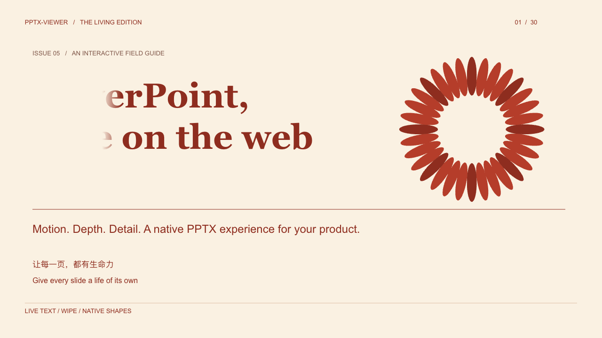
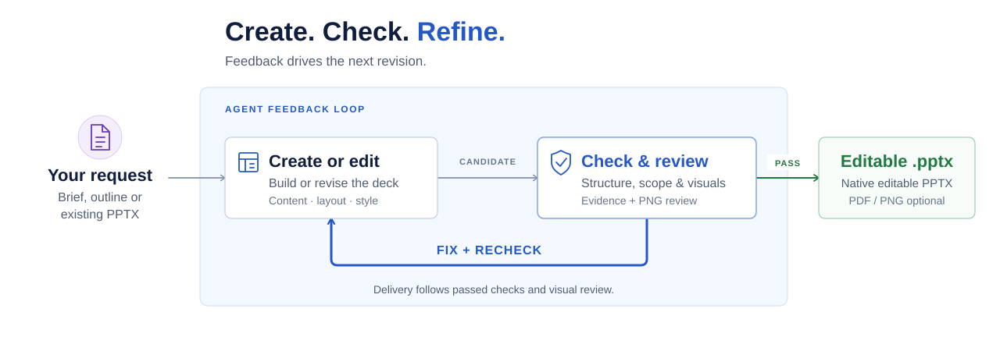

# pptx-nova

[English](README.md) | 简体中文

`pptx-nova` 是一个用于创建、编辑、翻新、翻译和检查 PowerPoint 演示文稿的 Agent 技能。
它旨在交付真正可编辑的 `.pptx` 文件，而不是将幻灯片截图粘贴成演示文稿。

当你希望 AI Agent 将需求简述、大纲、Markdown/文本文档、粘贴的表格、CSV/JSON 数据、
参考演示文稿或已有演示文稿转为可编辑的 PowerPoint 文件时，可以使用它。
主要目标应用是 PowerPoint；Keynote 和其他兼容的办公套件通常也能打开生成的文件，
具体效果取决于它们对 PPTX 的兼容性。

## 查看效果

[](https://structurify.io/en/showcases/copper-motion/)

这段 20 秒的录屏展示了浏览器中的原生 PPTX 播放效果。点击预览可查看完整的交互演示。

直接在浏览器中浏览使用 `pptx-nova` 创建的演示文稿：

- [Quiet Canvas](https://structurify.io/en/showcases/quiet-canvas/) · [PPTX 源文件](showcases/D1-Quiet-Canvas.pptx)
- [Electric Stage](https://structurify.io/en/showcases/electric-stage/) · [PPTX 源文件](showcases/D2-Electric-Stage.pptx)
- [Copper Motion](https://structurify.io/en/showcases/copper-motion/) · [PPTX 源文件](showcases/D5-Copper-Motion.pptx)
- [Signal Depth](https://structurify.io/en/showcases/signal-depth/) · [PPTX 源文件](showcases/D6-Signal-Depth.pptx)

提示：点击示例右下角的三角形播放按钮，即可查看播放效果。
**这些都是真正的原生、可编辑 PPTX 文件！**

## 让 AI 帮你安装

打开支持本地 Skill、能够安装依赖和访问文件的 AI 助手，例如 Claude Code 或 Codex，
直接发送这句话：

```text
帮我安装 hustcer/pptx-nova 仓库中的 pptx-nova skill 以及相关依赖。
安装完成后，请检查是否可以正常使用。
```

由 AI 根据你的环境选择安装方式，安装技能和用于处理 PowerPoint 文件的 `xdoc` 运行时，
并检查配置。请让它确认：

- 当前使用的 AI 助手可以识别并使用 `pptx-nova`。
- 所需运行环境已安装，并能在该 AI 助手的环境中正常运行。
- 当前任务是否需要许可证，以及还有哪些步骤需要你完成。

<details>
<summary>手动安装（可选）</summary>

以下基于 npm 的安装步骤需要 Node.js 22.20 或更新版本，
以满足 [skills CLI](https://github.com/vercel-labs/skills#install-a-skill) 的要求。

从本仓库中只安装面向用户的 `pptx-nova` 技能：

```bash
npx skills add hustcer/pptx-nova --skill pptx-nova
```

默认安装范围是当前项目。如需为指定 Agent 全局安装：

```bash
# Claude Code
npx skills add hustcer/pptx-nova --skill pptx-nova -g -a claude-code -y

# Codex
npx skills add hustcer/pptx-nova --skill pptx-nova -g -a codex -y
```

`-g` 表示用户级安装，`-a` 用于选择 Agent，`-y` 用于跳过确认提示。
如需仅列出仓库中的技能而不安装，可运行 `npx skills add hustcer/pptx-nova --list`。
`deckkit-maker` 技能用于 DeckKit 开发，使用 `pptx-nova` 无需安装它。

技能安装工具不会安装 `xdoc` 运行时。实际创建、编辑、转换 PPTX 和生成预览，
还需要确保 Agent 的 `PATH` 中可以找到 `xdoc`。
单独安装文档中指定的运行时发布版：

```bash
npm i -g @s8fy/xdoc@0.22.0
xdoc --version
```

原生安装包、平台要求和运行时验证方法见 [xdoc 安装指南](docs/xdoc-installation.md)。

</details>

## 制作第一份 PPT

安装检查通过后，向同一个 AI 助手发送以下请求。
如果它提示需要许可证，请先按下方的[许可证与套餐](#许可证与套餐)完成安装，再继续任务。

```text
使用 pptx-nova 制作一份 3 页的中文“远程办公入门”演示文稿，
采用简洁风格，保存到当前工作文件夹，文件名为 demo.pptx。
```

制作 PPTX 时，可以使用 DeckKit 统一配色、字体和页面布局。
先到 [DeckKit 预览图库](https://structurify.io/en/deckkits/) 查看效果，
选择适合内容和使用场景的 DeckKit，再在请求中告诉 AI 要使用的 DeckKit 名称。

任务成功后，AI 应提供可编辑 PPTX 文件的位置或链接。你可以在同一段对话中继续修改：

```text
把第 2 页的标题改得更简短，其他内容保持不变。
```

编辑已有演示文稿时，让 AI 能够读取 `.pptx` 文件或其本机路径，说明修改要求，
并指定新的输出文件名。编辑、翻译和导出示例见[常见请求](#常见请求)。

## 许可证与套餐

Free 无需账号或许可证，在下表所列限制内即可使用。
Personal 目前对个人本地非商业用途的价格为 0，但仍需申请并安装许可证。

| 项目                         | Free（免费版）             | Personal（需许可证）                                                           |
| ---------------------------- | -------------------------- | ------------------------------------------------------------------------------ |
| 当前价格                     | 免费                       | 0 — [申请许可证](https://structurify.io/en/commerce/?product=runtime-personal) |
| 许可证                       | 无需账号或许可证           | 个人离线许可证，有效期 30 天                                                   |
| 每个任务的幻灯片数量         | 最多 10 页                 | 套餐层面不设上限                                                               |
| 每个任务的压缩 PPTX 输入体积 | 合计最多 5 MiB             | 套餐层面不设上限                                                               |
| PPTX、PDF 和 PNG 输出        | 带有 `structurify.io` 水印 | 任务获得授权时不新增套餐水印                                                   |

两种套餐都支持单用户本地使用、本地脚本和用户级守护进程。
格式、资源限制以及已有签名水印规则仍然适用。
Personal 目前对个人本地非商业用途免费，近期暂无针对这类用途的收费计划。
许可证条款请参阅上方链接中的申请页面。

使用 Personal 的步骤：

1. [申请许可证](https://structurify.io/en/commerce/?product=runtime-personal)，
   获取 xdoc Runtime 许可证文件。
2. 让 AI 能够读取下载的许可证文件或其本机路径，然后发送：

   ```text
   帮我安装这份 xdoc Personal 许可证，并检查是否生效。
   ```

3. 让 AI 继续原来的演示文稿任务，并说明是否还有未解决的授权问题。

标准自动视觉检查需要无水印转换授权。如果 Free 无法完成必要检查，
请先安装可授权该任务的许可证后继续；Free 仍可生成带水印的预览。
续期时，提供新签发的许可证文件，让 AI 安装并检查即可。
安装、续期和授权诊断可由 AI 按[许可证工作流](pptx-nova/references/runtime/licensing.md)处理。

## 遇到问题时让 AI 帮忙

将错误原文交给 AI，让它诊断原因。你可以这样说：

| 遇到的问题             | 可以对 AI 说的话                                                          |
| ---------------------- | ------------------------------------------------------------------------- |
| 找不到技能或安装未完成 | 请检查 pptx-nova 是否已安装到当前 AI 助手，并验证相关依赖，帮我修复配置。 |
| 授权报错或出现意外水印 | 请检查当前任务使用的许可证，说明原因，以及继续任务需要做什么。            |
| 找不到生成的文件       | 请告诉我最终 PPTX 保存在哪里，并提供文件链接或完整路径。                  |

## pptx-nova 能做什么

- 根据简短需求、结构化大纲、Markdown/文本文档、PDF、网页、粘贴的表格或 CSV/JSON 数据创建演示文稿。
- 从结构化 JSON 演示文稿源文件重新构建可编辑 PPTX，便于版本管理、审阅、回放，
  以及结合视觉检查重新生成。
- 翻新已有演示文稿，以保留原始内容为目标，改善视觉系统的整洁度和一致性，
  并交付覆盖所有幻灯片的源文件与最终结果对比图，供用户审阅。
- 将已有 `.pptx` 翻译为另一种语言，尽量保留原始结构、布局、样式、对象、备注、动画和视觉层级，
  并交付覆盖所有幻灯片的源文件与译文对比图，供用户审阅。
- 编辑已有演示文稿，包括标题、文案、幻灯片顺序、视觉元素、颜色、图表、表格和指定页面元素。
- 保留针对当前演示文稿的明确后续规则，例如让以后新增的幻灯片沿用相同的标题颜色，
  并在最终 PPTX 中验证受支持的规则。
- 检查真实 PPTX 结构，精确选择目标对象，试运行编辑，
  并将修改应用于经过验证的候选文件后再发布最终文件。
- 以公司模板或参考演示文稿为指导，同时避免未经批准复用私有或不可再分发的素材。
- 将受支持的内容填入已有 PPTX 模板，或在演示文稿之间复制指定幻灯片，
  具体受模板、幻灯片尺寸和资源检查约束。
- 在支持范围内，通过 DeckKit 和 `xdoc` 工作流应用或检查品牌、主题及视觉系统变更。
- 根据 CSV/JSON 数据生成数据驱动的幻灯片，在支持范围内使用可编辑的表格、图表、示意图和形状。
- 创建或安全编辑受支持的 PPTX 动画和切换效果。
- 将已有或生成的 PPTX 导出为高保真 PDF，并渲染 PNG 预览供视觉审阅。
- 以 Markdown、文本或 JSON 提取受支持的演示文稿内容和元数据，
  包括备注、链接、字体及资源；执行字体、链接、兼容性或无障碍预检。
- 执行质量检查，查找重叠、文字裁切、布局漂移、模板违规、内容保留问题、视觉缺陷及修改前后的偏差。

## 常见请求

你可以直接用自然语言描述需求：

```text
使用 pptx-nova 为 SaaS 管理团队创建一份 8 页的英文产品战略演示文稿。
采用简洁的咨询风格，保存为 strategy-review.pptx。
```

也可以要求翻新已有演示文稿：

```text
翻新 qbr.pptx。保留内容和幻灯片数量，让视觉设计更加一致、适合管理层审阅，
导出 qbr-refined.pptx 和 PNG 预览。
```

或进行精确修改：

```text
更新 sales-review.pptx：修改第 2 页的标题，用 metrics.csv 中的数据替换第 5 页的
KPI 表格，将结果保存为 sales-review-v2.pptx。
```

或翻译演示文稿并保留源文件：

```text
将 product-launch.pptx 从中文翻译为英文。保留原始布局、格式、图表、演讲者备注、
动画和幻灯片数量。使用简洁的美式英语术语，保存为 product-launch-en.pptx。
```

或导出已有演示文稿：

```text
将 proposal.pptx 转换为高保真 PDF，保存为 proposal.pdf。
```

或复用已有模板：

```text
用 metrics.csv 中的季度业绩数据填充 company-template.pptx。
保留公司的视觉风格，将新演示文稿保存为 quarterly-results.pptx。
```

## 需要提供什么

一句话也能开始任务，但通常提供以下信息会得到更好的结果：

- 用途：路演、董事会汇报、季度业务回顾（QBR）、销售演示、培训、方案、课程或研讨会。
- 受众：管理层、客户、投资者、销售团队、学生、内部团队或公开会议听众。
- 篇幅：准确的幻灯片数量或大致范围。
- 语言：英文、中文、双语或其他目标语言。
- 源材料：大纲、笔记、Markdown/文本内容、已有 PPTX、PDF、CSV/JSON、截图、链接、
  产品文案、品牌素材或模板演示文稿。
- 翻译目标：如果源文稿包含多种语言或语言不明确，请说明源语言；同时提供目标语言和地区、
  术语偏好、语气，以及是否需要本地化图表标签、替代文本、链接文字及提示或演讲者备注。
- 风格方向：正式、极简、咨询、技术、编辑设计、产品营销、培训或严格遵循品牌模板。
- 约束：不能修改的内容、必须保留的幻灯片、是否允许调整结构，以及所需输出路径。

默认情况下，pptx-nova 不应覆盖原始演示文稿。
除非你明确希望替换文件，否则请指定新的输出文件名。

HTML、网页和 PDF 被视为源材料。它们会先规范化为文本或 Markdown，再进入演示文稿工作流；
pptx-nova 不承诺将其原始页面布局、图像或样式一比一复制到 PowerPoint 中。
PDF 提取质量取决于源文件；扫描件或嵌入字体可能导致缺字或阅读顺序错误，因此需要检查提取内容。
CSV 和 JSON 可以提供表格数据；任意 JSON、Excel 工作簿和 Word 文档不能直接作为演示文稿输入。

## 输出内容

一次正常运行可以生成：

- 最终可编辑的 `.pptx` 文件。
- 高保真 PDF 导出，以及可选的逐页 PNG 预览。
- 可选的视觉检查、模板检查和内容保留检查报告。
- 对于翻译或翻新任务，提供覆盖每一页源幻灯片及其交付结果的并排对比图。
  不超过 20 页的演示文稿使用一张图；更长的演示文稿使用带编号的多张图和覆盖清单。
- 对于翻译任务，可选提供源语言与目标语言审阅说明，列出翻译内容、有意缩短的内容，
  以及仍需人工审阅的布局风险。
- 简短的变更摘要和剩余审阅风险说明。

运行证据通常保存在 `.pptx-nova/<run>/` 下，包括能力快照、相关计划或补丁、验证报告及视觉审阅产物。
成功运行的产物可以在保留关键证据的前提下精简；失败或中断的运行则会保留，以便检查或恢复。

对于重要演示文稿，应将生成的文件视为一份质量较高的初稿，
仍需人工核对事实、主张、数字、品牌合规性和法律措辞。

## 由 [`xdoc`](docs/xdoc-introducution.md) 驱动

xdoc 是面向 Agent 的文档执行运行时，用于处理原生、可编辑的 PPTX。

> **xdoc 是一个高性能、以 Agent 为先、无需图形界面的 PPTX 运行时，专为高保真创建和编辑而构建。**

已核对的发布版为 `0.22.0 (80bf93e7e)`。它提供运行时能力发现、原生可编辑内容的创建和修改、
试运行、保留情况诊断、渲染、验证，以及可审计的证据。
支持范围取决于具体对象和操作，不代表完全覆盖 PowerPoint 的所有功能。

pptx-nova 基于 `xdoc` 构建，后者是一个为 AI Agent 自研的 PPTX 引擎。
它可以检查真实的 PowerPoint 文件结构，通过试运行验证声明式 JSON 补丁，
应用原生可编辑修改，渲染预览，比较源演示文稿和候选演示文稿，
将已有或生成的演示文稿导出为高保真 PDF，并留下可回放的伴随证据（sidecar）。

这些功能通过一个集成渲染后端的轻量原生 CLI 提供：
预览、PDF 导出和视觉检查均无需 PowerPoint、办公套件或无头浏览器。
当前 `v0.22.0` 原生安装包的下载大小因目标平台而异，约为 8.4–10.3 MB（十进制），
无需独立服务器或始终运行的后台服务。
原生构建支持 Linux x64/ARM64、macOS 13+ ARM64 和 Windows x64。
渲染效果仍取决于可用字体和所需功能的支持状态。

使用 `npm i -g @s8fy/xdoc@0.22.0`（Node.js 22+）安装已发布的 CLI，
或使用[原生发布安装包](docs/xdoc-installation.md)。Free 模式支持单用户本地任务，
每个任务最多 10 页幻灯片、压缩 PPTX 输入合计最多 5 MiB；
可编辑 PPTX、PDF 和 PNG 输出均带有 `structurify.io` 水印。
支持本地脚本和用户级守护进程。首发的 Free、Personal 和 Enterprise 套餐
不包含 CI、共享服务器或 Service/API 用途；在这些环境中部署需要另行取得适用授权。
公开下载默认适用非商业条款，另有许可的情况除外。
标准自动化视觉审计需要无水印转换授权；Free 模式仍可生成带水印的预览供审阅。

这改变了演示文稿的制作方式：pptx-nova 可以用 DeckKit 规划演示文稿，
编辑真实 PPTX 对象，写入前检查选择器，默认保留原始演示文稿，
并生成审阅产物，让结果可以被审计。
它更接近结构化的 PPTX 构建和编辑流水线，而非一次性的幻灯片生成器。

### 基于原文件的局部编辑

`xdoc` 以原始 PPTX 为基础，对目标对象及相关结构做局部修改，无需重建整份演示文稿。
未涉及的 OOXML 部件、对象关系和扩展数据会尽可能保留。
源文件默认保持只读，结果作为经过单独验证的候选文件发布。

## 工作原理

描述你需要的结果，pptx-nova 会创建或编辑演示文稿，执行检查，
并结合机器检查结果和视觉审阅指导下一轮修改。
修复后重新验证，通过必要的检查和审阅后再交付。

<p align="center">
  
</p>

新演示文稿使用 DeckKit：一套可复用的视觉系统，包含页面类型、排版、布局规则和质量检查。
已有演示文稿则通过限定范围的修改来编辑其原生对象，原始文件默认保持只读。

详细步骤、验证关卡和重试路径见[完整的创建与编辑工作流](docs/workflows.md)。

### 能力与播放边界

pptx-nova 每次运行都会从已安装的 `xdoc` 运行时发现可用能力。
创建、编辑、保留、渲染和验证对象是不同的能力：某项功能可以被保留或渲染，并不代表它可以被编辑。
复杂动画和其他未受支持的区域可能需要保持不变，或采用其他工作流。
当前支持边界见[兼容性说明](docs/xdoc-compatibility.md)。

PNG 和 PDF 预览展示的是静态幻灯片，不能证明动画或切换效果能在 PowerPoint 中正确播放。
如果播放效果很重要，请在目标演示环境中审阅；缺少播放验证证据时，应将其列为剩余审阅风险。

### 限定范围的编辑安全

对于局部编辑，pptx-nova 会在写入前记录预期范围，
仅在确定性检查确认以下条件后才发布候选文件：

- 已覆盖请求的目标，且没有可靠证据表明存在范围外修改；
- 源文件、候选文件和验证证据仍相互对应；
- 相关格式检查和视觉回归检查已通过。

检查失败时会阻止交付，并给出具体的下一步操作，而不是静默交付。
复杂或不确定的 PPTX 区域仍可能需要专项检查或人工审阅。

### 可靠的后续规则

对于围绕同一份演示文稿进行的多轮工作，pptx-nova 可以保留明确的未来或延续指令，
而不是依赖临时聊天记忆。它会将规则关联到当前演示文稿版本，处理冲突和一次性覆盖，
并在交付前于最终 PPTX 中验证受支持的样式规则。

目前的支持范围有意保持收敛且确定。它不会从模糊反馈中推断长期偏好、建立跨项目用户画像，
也不允许会话规则绕过模板和质量检查。
不适用于当前编辑的规则不会额外增加编辑目标或交付证据。

这些特点让 pptx-nova 有别于许多通用幻灯片生成器、截图流水线或小型 PowerPoint 脚本片段：

- 目标是生成原生可编辑的 PPTX 对象，而不是由扁平幻灯片图片组成的演示文稿。
- 保留持久化计划（`outline.json`、`deck_lock.json`、`content.json` 或 `patch.json`），
  使工作可以被审阅、回放和继续执行。
- 使用 `xdoc` 的 `inspect`、`select`、`dry-run`、`apply`、`preview`、`vision-check`、`diff`
  以及伴随证据与回放能力，为实际文件写入提供保障。
- 默认将原始演示文稿视为只读文件，先写入经过验证的候选文件，再发布最终文件。
- 留下精简的报告和预览审计记录，让用户了解修改了什么、检查了什么，以及哪些内容仍需人工审阅。

最终结果仍应像任何商务演示文稿一样接受审阅，尤其是事实、数字、法律措辞和品牌审批。
这套工作流旨在让审阅更容易：演示文稿保持可编辑，修改可以追溯，并在交付前检查视觉缺陷。

## 翻译演示文稿

翻译按保留样式的编辑任务处理，而不是重建演示文稿。
源文件保持只读，翻译后的文件写入单独的输出路径。

提出翻译请求时，至少提供：

- 源 `.pptx` 路径。
- 目标语言；如果演示文稿包含多种语言或语言不明确，也请说明源语言。
- 输出 `.pptx` 路径。
- 术语、地区、语气或品牌措辞要求。

除非你明确要求更大范围的重新设计，否则翻译会尽量保留粗体、斜体、下划线、删除线、颜色、
字体、对齐、项目符号、缩进、文本框几何属性、表格和图表样式、超链接、备注、动画和切换效果。

译文的长度和换行往往不同，因此应谨慎调整内容适配：
先尝试在不改变含义的前提下缩短措辞，必要时再小幅调整字号，
只有页面明确有足够空间时才修改文本框的几何属性。

翻译检查不应仅覆盖普通幻灯片文字。图表标题、系列名称、分类标签、数据标签、表格单元格、
替代文本、超链接提示和演讲者备注也可能包含用户可见文本，需要翻译。

不能仅凭文本替换成功就认定翻译完成。最终审阅必须确认目标语言演示文稿仍保持源演示文稿的外观，
没有遗留应翻译的可见源语言文字，也没有新增裁切、重叠、图表标签异常、格式丢失或 PowerPoint 修复问题。

## 仓库结构

```text
.
+-- pptx-nova/                 # 主要对外发布的 pptx-nova 技能
|   +-- README.md              # 英文使用指南
|   +-- README.zh-CN.md         # 中文使用指南
|   +-- SKILL.md               # Agent 指令和任务路由
|   +-- assets/                # DeckKit、示例、主题、图标和 Schema
|   +-- benchmarks/visual/     # 视觉基准测试案例和基线
|   +-- references/            # 面向 Agent 和维护者的工作流参考
|   +-- scripts/               # 技能运行时脚本和辅助检查
|   `-- evals/                 # 技能评估元数据
+-- deckkit-maker/             # 用于创建 DeckKit 的开发者辅助技能
`-- tools/                     # 仓库级冒烟测试和公开发布检查
```

## DeckKit 预览

制作 PPTX 时，可以使用 DeckKit 统一配色、字体和页面布局。
先到 [DeckKit 预览图库](https://structurify.io/en/deckkits/) 查看效果，
选择适合内容和使用场景的 DeckKit，再在请求中告诉 AI 要使用的 DeckKit 名称。

## 关于 deckkit-maker

`deckkit-maker` 是随仓库提供的配套开发者技能，
用于根据参考 `.pptx` 文件或 HTML 幻灯片模板，为 pptx-nova 创建、修复新 DeckKit 并进行基准测试。

它不是面向普通用户的主要演示文稿生成入口。常规的创建、编辑、翻新和质量检查请使用 `pptx-nova`。
只有在现有 DeckKit 不足以满足需求，需要构建或扩展可复用视觉系统本身时，才使用 `deckkit-maker`。

## 我们的其他产品

- **[xdoc Runtime](https://structurify.io/en/products/pptx-runtime/)** — 面向 Agent 的原生 CLI，
  用于检查、创建、编辑、渲染和验证 PowerPoint 文件。
- **[PPTX Viewer](https://structurify.io/en/products/pptx-viewer/)** — 浏览器 SDK，
  用于 PowerPoint 预览和受支持的动画播放，提供 Web Component 和框架集成。
- **[PPTX Converter](https://structurify.io/en/products/pptx-converter/)** — 在浏览器、Node.js、Bun 和 Deno 中
  本地执行 PPTX 转 PDF 和 Markdown 的 SDK。
- **[PPTX API Service](https://structurify.io/en/products/pptx-api/)** — 专为**通过 Docker 镜像私有部署**设计的
  HTTP 服务，提供 PPTX 转换、提取和检查功能。
  目前为仅监听本机回环地址的开发预览版，暂不支持生产部署。

## 致谢

- [Tabler Icons](https://github.com/tabler/tabler-icons)
- [PPT Master](https://github.com/hugohe3/ppt-master)
- [Beautiful HTML Templates](https://github.com/zarazhangrui/beautiful-html-templates)
- [PPTAgent: Generating and Evaluating Presentations Beyond Text-to-Slides](https://arxiv.org/abs/2501.03936)

## 更多文档

- [pptx-nova 英文使用指南](pptx-nova/README.md)
- [pptx-nova 中文使用指南](pptx-nova/README.zh-CN.md)
- [xdoc 简介与架构](docs/xdoc-introducution.md)
- [安装 xdoc CLI](docs/xdoc-installation.md)
- [xdoc 兼容性说明](docs/xdoc-compatibility.md)
- [DeckKit 预览图库](https://structurify.io/en/deckkits/)
