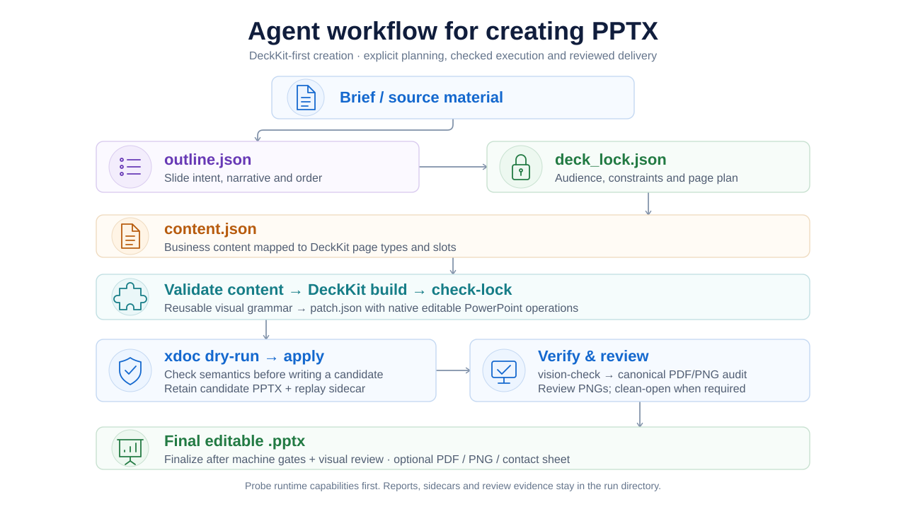
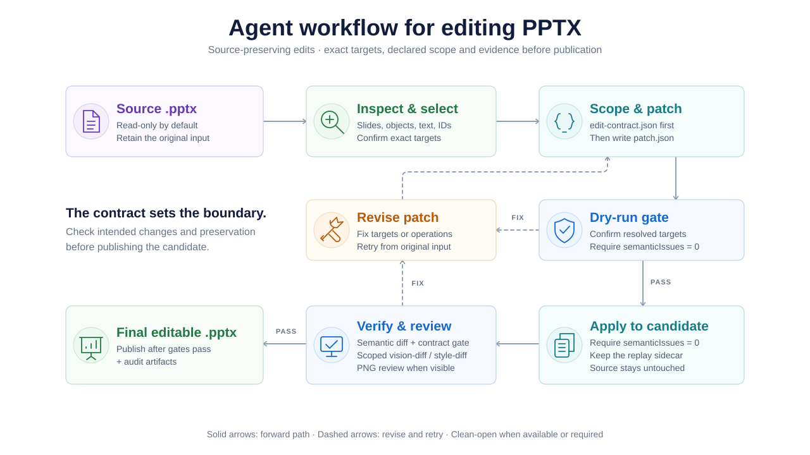

# Creating and editing PowerPoint presentations

`pptx-nova` has two paths: compose a new presentation from source material, or
make scoped changes to an existing PPTX. Both produce a candidate for validation
and visual review before delivery. Findings feed back into content, layout, or
patch revision, followed by fresh validation and review. The diagrams below show
the normal workflows; the task and installed runtime determine which specialized
checks are required. Unresolved or ambiguous issues can require user input;
iteration does not bypass a failed delivery gate.

## Create a new presentation

A DeckKit provides reusable page types, layout rules, typography, and visual
components. The Agent plans the narrative and content, then uses that visual
system to build native editable PowerPoint objects.

1. Turn the brief and source material into `outline.json` and `deck_lock.json`,
   recording slide intent, audience, constraints, and the page plan.
2. Map business content to DeckKit page types and slots in `content.json`.
   Validate the content, build `patch.json`, and check it against the design lock.
3. Run `xdoc` dry-run before apply. Successful apply writes a candidate PPTX and,
   by default, a replay sidecar; reports remain in the run directory.
4. Check the candidate and render canonical PDF/PNG evidence on supported
   runtimes. Review the PNGs and complete any required clean-open or specialized
   checks. Finalize only after the machine gates and bound visual review pass.

The create runner pauses for visual review before publishing the final file.
Older runtimes can provide diagnostic previews but require the documented
human-confirmation route instead of automatic finalization. Failed checks return
to content, layout, or patch revision.

For the executable workflow, see [DeckKit mode](../pptx-nova/references/create/deckkit-mode.md)
and the [create runner](../pptx-nova/scripts/cli/create/run.mjs).

## Edit an existing presentation

The existing deck remains the source of truth. The Agent inspects its real
objects, records the intended change boundary, and applies a declarative patch
to a separate candidate. The original stays read-only by default.

1. Inspect the source and select exact target objects using text, names, IDs,
   placeholders, or other supported selectors.
2. Bind requested changes and preservation requirements in `edit-contract.json`
   before writing `patch.json`. Resolve applicable follow-up rules when present.
3. Dry-run the patch and confirm that resolved targets match the request and
   `semanticIssues` is empty. Revise failed patches and retry from the retained
   original input.
4. Apply to a candidate, again requiring an empty `semanticIssues` list. Collect
   semantic diff, scoped visual diff, style diff, and structural evidence as
   required by the contract. Review PNGs for visible changes and run the contract
   gate before publishing. Failed evidence gates return to patch revision.

Scoped visual checks distinguish new or worsened issues from inherited source
issues. Clean-open and other specialized checks depend on availability and task
risk. The final summary should identify checks actually run and any residual
risks that need review.

See [Edit mode](../pptx-nova/references/edit/edit-mode.md) and
[Edit Contract](../pptx-nova/references/edit/edit-contract.md) for the detailed rules.

## Diagram sources

The [diagram source index](diagrams/README.md) links the editable HTML files and
SVG exports, documents the overview's simplifications, and explains how to
update the figures.

[Back to the repository README](../README.md#how-it-works)
